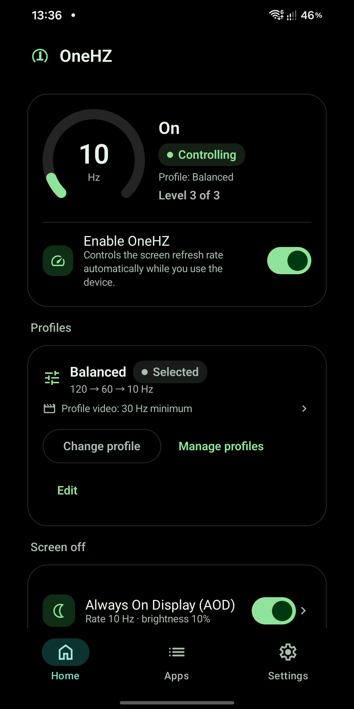
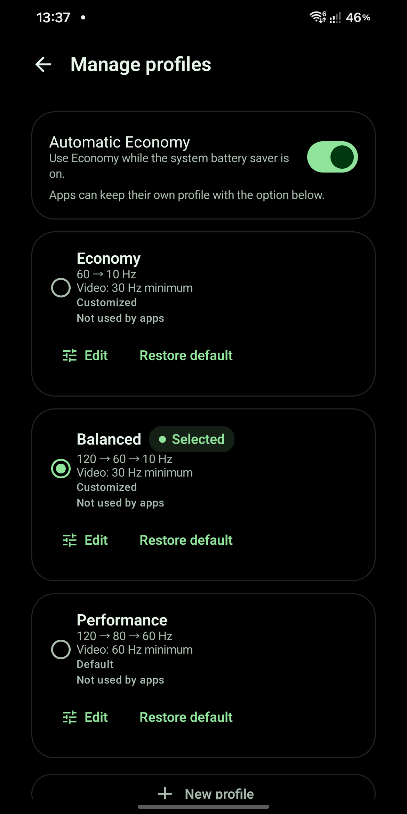
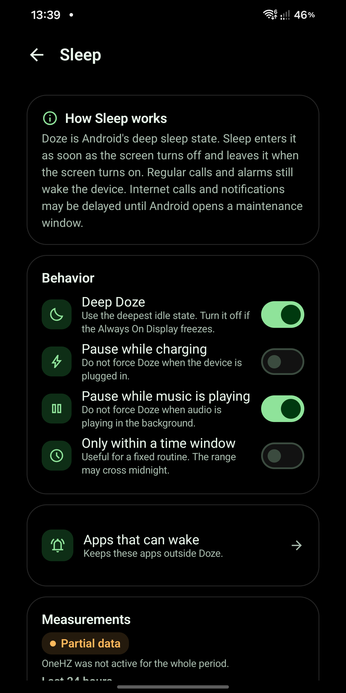

<p align="center">
  
</p>

<h1 align="center">OneHZ</h1>

<p align="center">
  <b>Refresh-rate control for Samsung and Xiaomi/Redmi/POCO displays — Shizuku only.</b><br>
  Smoother when you touch, quieter at rest, lighter with the screen off.
</p>

**English** · [Português (Brasil)](README.pt-BR.md)

<p align="center">
  <a href="LICENSE"></a>
  <a href="https://developer.android.com"></a>
  <a href="#requirements"></a>
  <a href="PRIVACY.md"></a>
  <a href="https://github.com/sponsors/neveSZ"></a>
  <a href="https://livepix.gg/onehz"></a>
</p>

<p align="center">
  <a href="https://shizustore.com/apps/onehz"></a>
  &nbsp;&nbsp;
  <a href="../../releases/latest"></a>
  &nbsp;&nbsp;
  <a href="https://apps.obtainium.imranr.dev/redirect?r=obtainium://add/https%3A%2F%2Fgithub.com%2FneveSZ%2Fonehz"></a>
</p>

<p align="center">
  <a href="fastlane/metadata/android/en-US/images/phoneScreenshots/1.png"></a>
  <a href="fastlane/metadata/android/en-US/images/phoneScreenshots/2.png"></a>
  <a href="fastlane/metadata/android/en-US/images/phoneScreenshots/4.png"></a>
</p>

OneHZ changes the display refresh rate through **Shizuku only** — no root, no direct ADB
from the app, no `WRITE_SECURE_SETTINGS`, and **no AccessibilityService**.

> **Personal project.** I built OneHZ for my own daily use. I do not provide a
> maintenance guarantee, but I am open to bug reports and suggestions. Use it at your own
> risk. All features are free and open source; donations never unlock anything.

---

## Status

| | |
|---|---|
| Latest release | **1.2.1** (stable) |
| Previous stable | **1.2.0** |
| Tested devices | Samsung Galaxy S25+ (`SM-S936B`), POCO X7 Pro (`2412DPC0AG`) |
| Vendors | Samsung, Xiaomi/Redmi/POCO |
| Verdict | Multi-rate display required, LTPO **not** required |

Beta builds are published as pre-releases and are opt-in; stable users stay on the stable
channel.

## Requirements

| Requirement | Detail |
|---|---|
| Device | Samsung phone **or** Xiaomi/Redmi/POCO phone (HyperOS/MIUI) |
| Display | At least **two refresh rates** (for example 120/90/60/30) |
| Android | **12 (API 31) or newer** (`minSdk 31`; Android 16 and 17 tested) |
| Shizuku | Installed and running |
| Distribution | Signed APK from GitHub Releases, Shizu Store and Obtainium; not on Google Play |

## Install

1. Install Shizuku and start it through wireless debugging or root. The tested fork is
   [thedjchi `v13.7.0-thedjchi`](https://github.com/thedjchi/Shizuku/tree/v13.7.0-thedjchi).
2. **Recommended:** install and update from [Shizu Store](https://shizustore.com/apps/onehz).
   You can also install the APK from [GitHub Releases](../../releases/latest), or add the
   repository to [Obtainium](https://obtainium.imranr.dev/) using the badge above.
3. Open OneHZ, allow the Shizuku permission, and follow the setup screen.
4. Turn on the master switch.

Updates, uninstall, beta channel, APK verification, and recovery commands:
[docs/INSTALL.md](docs/INSTALL.md).

## Features

| Feature | What it does |
|---|---|
| **Refresh-rate staircase** | 1 to 5 descending tiers per profile, with per-tier hold times. |
| **Economy / Balanced / Performance** | Three device-aware profiles created on first open; the active one is selected manually. |
| **Automatic Economy** | Switches to Economy while the system battery saver is on. Can be disabled in **Manage profiles**; each app can keep its own profile. |
| **Custom profiles** | Create, edit, rename and delete profiles; built-ins restore to the device defaults. |
| **AOD rate** | Always the lowest rate exposed by the panel; the toggle is available on every supported device. |
| **AOD brightness** | Samsung only, with a safety band and a system restore action; on other devices the row is shown disabled with an explanation. |
| **Sleep (forced Doze)** | Optional and off by default. Enters Doze as soon as the screen turns off, with guards and local measurements. |
| **Per-app profiles** | Apps reference a saved profile, without copying the staircase or polling. |
| **Video mode** | A per-profile minimum rate while a video plays. Detection rules and the global forced-app list open in a dedicated sheet, and the card warns when no rule is active. |
| **Backup and restore** | Versioned JSON export/import of profiles, app assignments, video, AOD, Sleep settings and the master switch. Sleep measurements and the system Doze exceptions are not included. |
| **Wake pulse** | Applies the first tier on screen-on/unlock for about one second. |
| **Device-aware defaults** | Sensible profiles on a fresh install. |
| **Guided setup** | Display compatibility, Shizuku, battery/Doze, and notifications. |
| **No wake locks** | The optional foreground service does not keep the phone awake. |
| **Diagnostics** | In-memory log, filters, test actions, and a copyable report. |
| **Appearance** | System, light, dark, and AMOLED themes. |
| **Languages** | Portuguese (Brazil), English, and Spanish. |

Details, defaults, and behavior: [docs/FEATURES.md](docs/FEATURES.md).

## Ecosystem

| Project | Role in OneHZ | License |
|---|---|---|
| [Shizuku API](https://github.com/RikkaApps/Shizuku-API) by RikkaW | Bundled privileged API client | MIT |
| [Shizuku](https://github.com/RikkaApps/Shizuku) by RikkaApps | External app required at runtime (not bundled) | Apache-2.0 |
| [Shizuku fork](https://github.com/thedjchi/Shizuku/tree/v13.7.0-thedjchi) by thedjchi | External app used for testing (not bundled) | Apache-2.0 |
| [Adaptive Hz](https://github.com/mahmutaunal/Adaptive-Hz) by Mahmut Alperen Ünal | Portions derived into OneHZ | MIT |
| [Obtainium](https://github.com/ImranR98/Obtainium) | Update client; badge only in the docs | GPL-3.0 |
| [Jetpack Compose](https://developer.android.com/jetpack/compose) | UI toolkit | Apache-2.0 |

Full credits: [CREDITS.md](CREDITS.md) and [THIRD_PARTY_NOTICES.md](THIRD_PARTY_NOTICES.md).

## Documentation

| User guide | Developer |
|---|---|
| [Features](docs/FEATURES.md) | [Architecture](docs/ARCHITECTURE.md) |
| [Install and update](docs/INSTALL.md) | [Building](docs/BUILDING.md) |
| [Compatibility](docs/COMPATIBILITY.md) | [Testing](docs/TESTING.md) |
| [FAQ](docs/FAQ.md) | [Releasing](docs/RELEASING.md) |
| [Privacy](PRIVACY.md) | [Security](SECURITY.md) |
| [Credits](CREDITS.md) | [Backlog](docs/BACKLOG.md) · [Translations](docs/TRANSLATIONS.md) |

## Privacy

OneHZ has no analytics, advertising, telemetry, crash reporting, or accounts. Settings
and diagnostics stay on the device. The `INTERNET` permission is used only by the
optional update checker, which is **off by default**. See [PRIVACY.md](PRIVACY.md).

## Verify the APK

Every release includes a `.sha256` file. The signing certificate SHA-256 is:

`D8:E8:24:B2:5F:6B:1D:29:75:BD:72:D6:89:5F:C4:7F:7B:EB:C2:05:78:41:F7:83:3C:25:67:0A:C2:04:F8:0A`

```powershell
apksigner verify --print-certs OneHZ-1.2.1.apk
```

See [docs/INSTALL.md#verify-the-apk](docs/INSTALL.md#verify-the-apk).

## Support

All features are free and open source. Donations are optional and never unlock anything.

- **International:** [GitHub Sponsors](https://github.com/sponsors/neveSZ) — monthly or
  one-time.
- **Brazil:** [LivePix](https://livepix.gg/onehz) — Pix in BRL.

Both links are also available in the app under **About → Support OneHZ**. Bug reports and
suggestions are welcome through GitHub Issues. Include your device model, Android/One
UI/HyperOS build, Shizuku version, OneHZ version, and the diagnostic report. Remove any
personal data before posting.

## License and credits

OneHZ is released under the **MIT License**. See [LICENSE](LICENSE) and the
[unofficial Portuguese translation](LICENSE.pt-BR.md). Portions are derived from Adaptive
Hz (MIT, © 2025 Mahmut Alperen Ünal). Third-party components and documentation assets
remain under their own licenses; see [THIRD_PARTY_NOTICES.md](THIRD_PARTY_NOTICES.md).

- **Author:** [neveSZ](https://github.com/neveSZ).
- **LLM assistance:** developed with help from LLMs through the
  [OpenCode](https://opencode.ai) coding agent harness, then reviewed and tested by the
  author.
- **Adaptive Hz** by Mahmut Alperen Ünal (MIT): OneHZ includes portions derived from it.
- **Shizuku API** by RikkaW (MIT): bundled in the app.
- **Shizuku app** by RikkaApps (Apache 2.0) and the **thedjchi fork** (Apache 2.0):
  installed separately; not bundled.
- **AndroidX / Jetpack Compose / Kotlin / kotlinx.coroutines** (Apache 2.0).
- **JUnit 4** (test only, Eclipse Public License 1.0; not distributed in the app).
- **Obtainium badge** (GPL-3.0): documentation only, not part of the APK and not covered
  by the MIT license; see [docs/assets/README.md](docs/assets/README.md) and
  [LICENSES/GPL-3.0.txt](LICENSES/GPL-3.0.txt).
- **Shizu Store badge** (GPL-3.0): documentation only, not part of the APK and not
  covered by the MIT license; see [docs/assets/README.md](docs/assets/README.md).
- **Gradle Wrapper** (Apache 2.0): build only, not part of the APK.

No code or assets from closed-source applications are included.

### Translations

- **Português (Brasil):** reviewed by the author.
- **English:** AI-generated, **not reviewed by a native speaker**.
- **Español:** AI-generated, reviewed for consistency, **not reviewed by a native
  speaker**.

Corrections are welcome. See [docs/TRANSLATIONS.md](docs/TRANSLATIONS.md).

## Disclaimer

OneHZ is not affiliated with, endorsed by, or sponsored by Samsung Electronics or
Xiaomi. Samsung, Galaxy, and One UI are trademarks of Samsung Electronics. Xiaomi, Redmi,
POCO, HyperOS, and MIUI are trademarks of Xiaomi. Android is a trademark of Google LLC.
Use OneHZ at your own risk; the software is provided “as is”, without warranty of any
kind.
