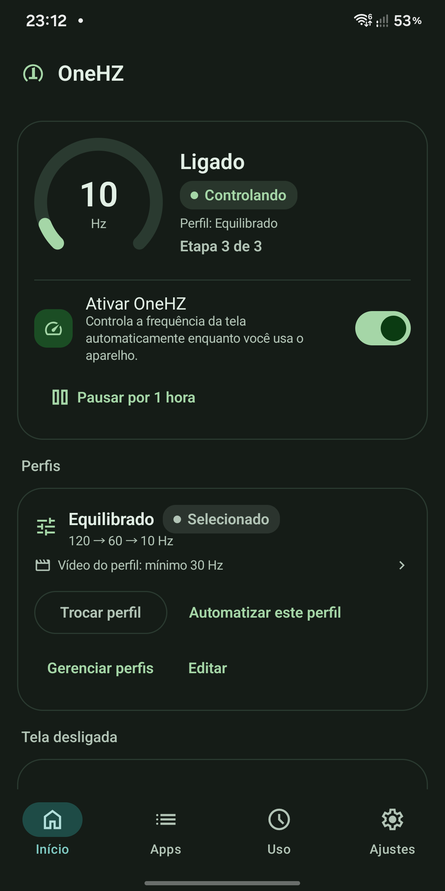
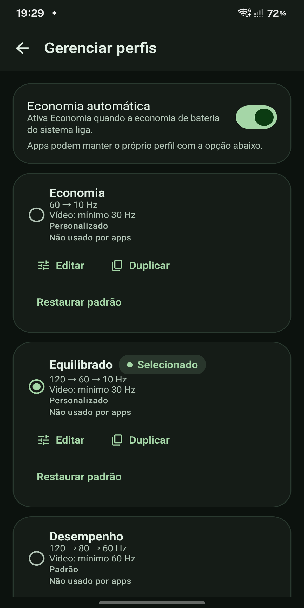
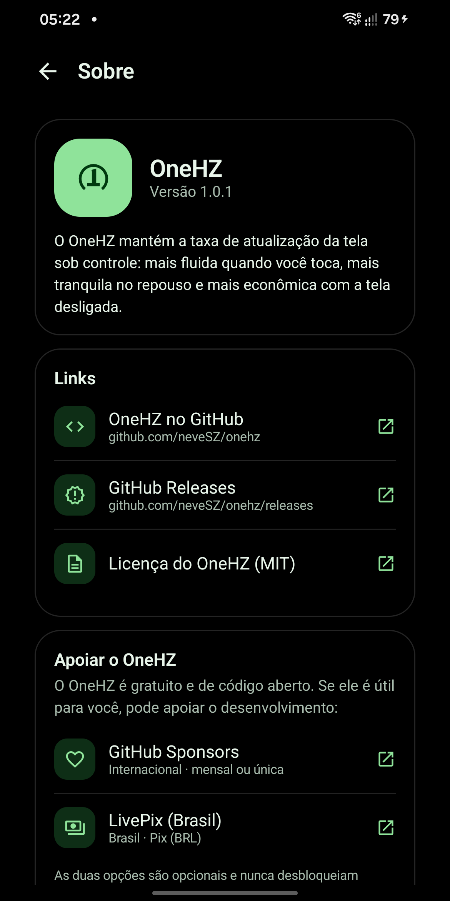

<p align="center">
  
</p>

<h1 align="center">OneHZ</h1>

<p align="center">
  <b>Controle de taxa de atualização para telas Samsung e Xiaomi/Redmi/POCO — somente Shizuku.</b><br>
  Mais fluido ao tocar, mais tranquilo no repouso e mais econômico com a tela desligada.
</p>

<p align="center">
  <a href="LICENSE"></a>
  <a href="https://developer.android.com"></a>
  <a href="#requisitos"></a>
  <a href="PRIVACY.md"></a>
  <a href="https://github.com/sponsors/neveSZ"></a>
  <a href="https://livepix.gg/onehz"></a>
</p>

<p align="center">
  <a href="https://shizustore.com/apps/onehz"></a>
  &nbsp;&nbsp;
  <a href="../../releases/latest"></a>
  &nbsp;&nbsp;
  <a href="https://apps.obtainium.imranr.dev/redirect?r=obtainium://add/https%3A%2F%2Fgithub.com%2FneveSZ%2Fonehz"></a>
</p>

<p align="center">
  <a href="fastlane/metadata/android/pt-BR/images/phoneScreenshots/1.png"></a>
  <a href="fastlane/metadata/android/pt-BR/images/phoneScreenshots/2.png"></a>
  <a href="fastlane/metadata/android/pt-BR/images/phoneScreenshots/4.png"></a>
</p>

[English](README.md) · **Português (Brasil)**

O OneHZ altera a taxa de atualização **exclusivamente pelo Shizuku** — sem root, sem ADB
direto pelo app, sem `WRITE_SECURE_SETTINGS` e **sem AccessibilityService**.

> **Projeto pessoal.** Criei o OneHZ para o meu uso diário. Não ofereço garantia de
> manutenção, mas estou aberto a relatos de bugs e sugestões. Use por sua conta e risco.
> Todas as funcionalidades são gratuitas e de código aberto; doações nunca desbloqueiam
> nada.

---

## Status

| | |
|---|---|
| Versão mais recente | **1.3.0** (estável) |
| Estável anterior | **1.2.1** |
| Aparelhos testados | Samsung Galaxy S25+ (`SM-S936B`), POCO X7 Pro (`2412DPC0AG`) |
| Fabricantes | Samsung, Xiaomi/Redmi/POCO |
| Veredito | Tela multi-taxa obrigatória; LTPO **não** é obrigatório |

Builds beta são publicadas como pré-releases e são opcionais; quem está no canal estável
continua no estável.

## Requisitos

| Requisito | Detalhe |
|---|---|
| Aparelho | Celular Samsung **ou** Xiaomi/Redmi/POCO (HyperOS/MIUI) |
| Tela | Pelo menos **duas taxas de atualização** (por exemplo 120/90/60/30) |
| Android | **12 (API 31) ou superior** (`minSdk 31`; Android 16 e 17 testados) |
| Shizuku | Instalado e em execução |
| Distribuição | APK assinado do GitHub Releases, Shizu Store e Obtainium; fora do Google Play |

## Instalação

1. Instale o Shizuku e inicie-o pela depuração sem fio ou root. O fork testado é o
   [thedjchi `v13.7.0-thedjchi`](https://github.com/thedjchi/Shizuku/tree/v13.7.0-thedjchi).
2. **Recomendado:** instale e atualize pelo [Shizu Store](https://shizustore.com/apps/onehz).
   Você também pode instalar o APK pelo [GitHub Releases](../../releases/latest) ou
   adicionar o repositório ao [Obtainium](https://obtainium.imranr.dev/) usando o badge
   acima.
3. Abra o OneHZ, permita o acesso ao Shizuku e siga a tela de configuração.
4. Ative a chave principal.

Atualizações, desinstalação, canal beta, verificação do APK e comandos de recuperação:
[docs/INSTALL.pt-BR.md](docs/INSTALL.pt-BR.md).

## Funcionalidades

| Recurso | O que faz |
|---|---|
| **Escada de taxa de atualização** | 1 a 5 faixas decrescentes por perfil, com tempo de espera em cada faixa. |
| **Controles rápidos** | Pausa de uma hora, tile nas Configurações Rápidas, notificação com estado (opcionalmente fixada) e atalhos do app. |
| **Regras de ativação** | Proteção de bateria baixa, carregador e janela de horário, cada uma apontando para um perfil salvo. |
| **Alvos por app** | Seguir um perfil, fixar uma taxa ou devolver o controle ao sistema. |
| **Uso** | Quarta aba da barra inferior. Tempo por taxa, AOD e sem controle, além da divisão por perfil, tudo local. |
| **Alterações no sistema** | Lista as chaves que o OneHZ pode gravar, mostra os valores originais, restaura tudo e exporta um relatório do painel. |
| **Automação** | Broadcasts explícitos de pausa, retomada, perfil e alternância para ferramentas de automação. |
| **Agenda noturna do AOD** | Janela de brilho somente Samsung dentro da faixa de segurança. |
| **Economia / Equilibrado / Desempenho** | Três perfis gerados conforme a tela na primeira abertura; o ativo é escolhido manualmente. |
| **Economia automática** | Troca para Economia enquanto a economia de bateria do sistema está ligada. Pode ser desligada em **Gerenciar perfis**; cada app pode manter o próprio perfil. |
| **Perfis customizados** | Criar, editar, renomear e excluir perfis; os base restauram para o padrão do aparelho. |
| **Taxa no AOD** | Sempre a menor taxa exposta pela tela; o switch está disponível em todos os aparelhos suportados. |
| **Brilho do AOD** | Somente Samsung, com faixa de segurança e ação de restauração do sistema; nos demais aparelhos a linha aparece desabilitada com explicação. |
| **Sono (Doze forçado)** | Opcional e desligado por padrão. Entra em Doze assim que a tela apaga, com filtros e medições locais. |
| **Perfis por aplicativo** | Apps referenciam um perfil salvo, sem copiar a escada e sem polling. |
| **Modo vídeo** | Piso de taxa por perfil enquanto um vídeo toca. As regras de detecção e a lista global de apps forçados abrem em uma sheet dedicada, e o card avisa quando nenhuma regra está ativa. |
| **Picture-in-picture** | Detectado pela tarefa fixada; o piso de vídeo continua ativo enquanto a janela está visível. |
| **Backup e restauração** | Exportação/importação JSON versionada de perfis, atribuições, regras de ativação, vídeo, AOD, configurações do Sono e switch mestre. Medições do Sono, a notificação fixa e exceções do Doze não entram. |
| **Pulso de despertar** | Aplica a primeira faixa ao ligar/destravar por cerca de um segundo. |
| **Padrões por dispositivo** | Perfis coerentes em uma instalação nova. |
| **Configuração guiada** | Compatibilidade da tela, Shizuku, bateria/Doze, notificações e um tile opcional nas Configurações Rápidas. |
| **Sem wake locks** | O serviço opcional em primeiro plano não mantém o aparelho acordado. |
| **Diagnóstico** | Log em memória, filtros, ações de teste e relatório copiável. |
| **Aparência** | Temas sistema, claro, escuro e AMOLED. |
| **Idiomas** | Português (Brasil), inglês e espanhol. |

Detalhes, padrões e comportamento: [docs/FEATURES.pt-BR.md](docs/FEATURES.pt-BR.md).

## Ecossistema

| Projeto | Papel no OneHZ | Licença |
|---|---|---|
| [Shizuku API](https://github.com/RikkaApps/Shizuku-API) por RikkaW | Cliente privilegiado embutido | MIT |
| [Shizuku](https://github.com/RikkaApps/Shizuku) por RikkaApps | App externo necessário em execução (não incluído) | Apache-2.0 |
| [Fork do Shizuku](https://github.com/thedjchi/Shizuku/tree/v13.7.0-thedjchi) do thedjchi | App externo usado nos testes (não incluído) | Apache-2.0 |
| [Adaptive Hz](https://github.com/mahmutaunal/Adaptive-Hz) de Mahmut Alperen Ünal | Porções derivadas no OneHZ | MIT |
| [Obtainium](https://github.com/ImranR98/Obtainium) | Cliente de atualizações; badge só na documentação | GPL-3.0 |
| [Jetpack Compose](https://developer.android.com/jetpack/compose) | Toolkit de interface | Apache-2.0 |

Créditos completos: [CREDITS.md](CREDITS.md) e
[THIRD_PARTY_NOTICES.md](THIRD_PARTY_NOTICES.md).

## Documentação

| Guia do usuário | Desenvolvimento |
|---|---|
| [Funcionalidades](docs/FEATURES.pt-BR.md) | [Arquitetura](docs/ARCHITECTURE.md) |
| [Instalação e atualização](docs/INSTALL.pt-BR.md) | [Compilação](docs/BUILDING.md) |
| [Compatibilidade](docs/COMPATIBILITY.pt-BR.md) | [Testes](docs/TESTING.md) |
| [Perguntas frequentes](docs/FAQ.pt-BR.md) | [Lançamento](docs/RELEASING.md) |
| [Privacidade](PRIVACY.md) | [Segurança](SECURITY.md) |
| [Créditos](CREDITS.md) | [Backlog](docs/BACKLOG.md) · [Traduções](docs/TRANSLATIONS.md) |

## Privacidade

O OneHZ não tem analytics, propaganda, telemetria, relatório de falhas nem contas. Os
ajustes e o diagnóstico ficam no aparelho. A permissão `INTERNET` é usada somente pela
verificação opcional de atualizações, que fica **desligada por padrão**. Veja
[PRIVACY.md](PRIVACY.md).

## Verificar o APK

Cada release inclui um arquivo `.sha256`. O SHA-256 do certificado de assinatura é:

`D8:E8:24:B2:5F:6B:1D:29:75:BD:72:D6:89:5F:C4:7F:7B:EB:C2:05:78:41:F7:83:3C:25:67:0A:C2:04:F8:0A`

```powershell
apksigner verify --print-certs OneHZ-1.3.0.apk
```

Veja [docs/INSTALL.pt-BR.md#verificar-o-apk](docs/INSTALL.pt-BR.md#verificar-o-apk).

## Apoio

Todas as funcionalidades são gratuitas e de código aberto. Doações são opcionais e nunca
desbloqueiam nada.

- **Fora do Brasil:** [GitHub Sponsors](https://github.com/sponsors/neveSZ) — mensal ou
  única.
- **Brasil:** [LivePix](https://livepix.gg/onehz) — Pix em BRL.

Os dois links também estão no app em **Sobre → Apoiar o OneHZ**. Relatos de bugs e
sugestões são bem-vindos pelo GitHub Issues. Inclua modelo do aparelho, build do
Android/One UI/HyperOS, versão do Shizuku, versão do OneHZ e o relatório de diagnóstico.
Remova dados pessoais antes de publicar.

## Licença e créditos

O OneHZ é distribuído sob a **Licença MIT**. Veja [LICENSE](LICENSE) e a
[tradução não oficial em português](LICENSE.pt-BR.md). Inclui porções derivadas do
Adaptive Hz (MIT, © 2025 Mahmut Alperen Ünal). Componentes de terceiros e assets de
documentação permanecem sob suas próprias licenças; veja
[THIRD_PARTY_NOTICES.md](THIRD_PARTY_NOTICES.md).

- **Autor:** [neveSZ](https://github.com/neveSZ).
- **Auxílio de LLM:** desenvolvido com ajuda de LLMs pelo harness
  [OpenCode](https://opencode.ai), depois revisado e testado pelo autor.
- **Adaptive Hz**, de Mahmut Alperen Ünal (MIT): o OneHZ inclui porções derivadas dele.
- **Shizuku API**, de RikkaW (MIT): embutida no app.
- **App Shizuku**, de RikkaApps (Apache 2.0), e o **fork do thedjchi** (Apache 2.0):
  instalados separadamente; não incluídos.
- **AndroidX / Jetpack Compose / Kotlin / kotlinx.coroutines** (Apache 2.0).
- **JUnit 4** (somente testes, Eclipse Public License 1.0; não distribuído no app).
- **Badge do Obtainium** (GPL-3.0): somente documentação, fora do APK e não coberto pela
  licença MIT; veja [docs/assets/README.md](docs/assets/README.md) e
  [LICENSES/GPL-3.0.txt](LICENSES/GPL-3.0.txt).
- **Badge do Shizu Store** (GPL-3.0): somente documentação, fora do APK e não coberto
  pela licença MIT; veja [docs/assets/README.md](docs/assets/README.md).
- **Gradle Wrapper** (Apache 2.0): somente build, fora do APK.

Nenhum código ou asset de aplicativos closed-source está incluído.

### Traduções

- **Português (Brasil):** revisado pelo autor.
- **Inglês:** gerado por IA, **não revisado por falante nativo**.
- **Espanhol:** gerado por IA, revisado para consistência, **não revisado por falante
  nativo**.

Correções são bem-vindas. Veja [docs/TRANSLATIONS.md](docs/TRANSLATIONS.md).

## Aviso legal

O OneHZ não é afiliado, endossado ou patrocinado pela Samsung Electronics nem pela
Xiaomi. Samsung, Galaxy e One UI são marcas da Samsung Electronics. Xiaomi, Redmi, POCO,
HyperOS e MIUI são marcas da Xiaomi. Android é uma marca da Google LLC. Use o OneHZ por
sua conta e risco; o software é fornecido “como está”, sem garantia de qualquer tipo.
